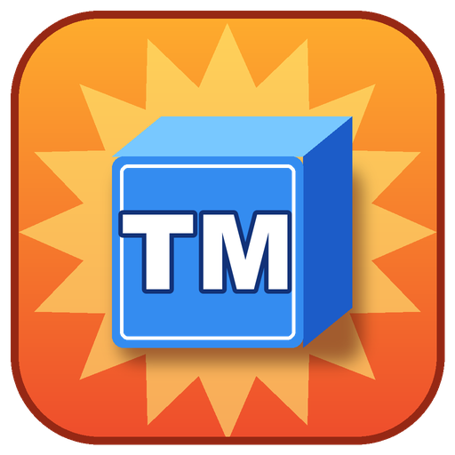

# Toybox Mayhem

A first-person arena shooter where living toys battle across a kid's bedroom, the backyard sandbox and a tabletop Toy City. Play against bots, or online with up to 8 friends.

**[⬇ Download for Windows (ToyboxMayhem-Setup.exe)](https://github.com/adirkverma25-maker/toyboxmahem/releases/latest/download/ToyboxMayhem-Setup.exe)**

## Install

You need Windows 10 or 11 (64-bit) and about 150 MB of space.

1. Download **ToyboxMayhem-Setup.exe** from the link above, or from the [Releases page](https://github.com/adirkverma25-maker/toyboxmahem/releases/latest).
2. Open the downloaded file.
3. Windows may show a blue box saying **"Windows protected your PC"**. This appears because the game isn't from a big publisher with a paid code-signing certificate. Click **More info**, then **Run anyway**.
   - If your browser warns that the file "isn't commonly downloaded", choose **Keep** (in Edge: click **…** → **Keep** → **Keep anyway**).
4. Follow the setup wizard. Click **Next** and **Install**. It installs just for you, so it doesn't ask for an admin password.
5. Start the game from the desktop shortcut or the Start menu (**Toybox Mayhem**).

**Updating:** download the latest Setup.exe and run it. It installs over the old version and keeps your progress.

**Uninstalling:** go to Windows **Settings → Apps → Installed apps**, find **Toybox Mayhem**, then **Uninstall**. Your progress is kept in `%APPDATA%\Godot\app_userdata\Toybox Mayhem`. Delete that folder too if you want a completely fresh start.

## Play with friends online

1. Everyone installs the game (see above).
2. One person clicks **Multiplayer → Host a room**. The game shows a 5-letter room code.
3. Everyone else clicks **Multiplayer**, types the code, and presses **Join**.
4. The host picks the mode, the map and how many bots fill the empty spots, then presses **Start match**.

Up to 8 players per room. Everyone needs the same version of the game.

## Modes

Walls, cover and glass can be shot and blown apart: blast your own way into a building.

## Classes

Pick a class in **Loadout**:

- **Light:** 100 health and faster. Blasters: Foam Fury, Rapid Rascal, Bubble Blaster, Thunderspring, Plunger Longbow, Starlight Zapper, Plasti-9. Pick two abilities from Wind-Up Dash, Spring Hook and Cloak. Melee: Toy Sword (wide, quick swings).
- **Medium:** 150 health but slower. Blasters: Brickbreaker, Popcorn Popper, Crayon Cannon, Jack-in-the-Blaster, Walloper. Always has the Mesh Shield and Cloak. Melee: Toy Spear (long reach).

Each class has its own gadgets too; they arrive in the next update.

- **Free-for-All:** everyone for themselves. First to 30 pops wins.
- **Team Deathmatch:** 4 v 4, first team to 50.
- **Toy Box Takeover:** hold the moving toy box to wind up your team's key.
- **Conquest:** three teams fight over six sectors.
- **Training Range:** practise on any map against toys that don't shoot back, and try any blaster.

## Controls

| Action | Keyboard / mouse | Controller |
| --- | --- | --- |
| Move | W A S D | Left stick |
| Look | Mouse | Right stick |
| Jump | Space | A |
| Crouch / slide | Ctrl or C | B |
| Sprint | Shift | Left stick click |
| Fire / aim | Left click / Right click | RT / LT |
| Reload | R | X |
| Revive teammate, grab a zipline | E | X |
| Switch weapon | 1 / 2 | Y |
| Abilities | Q / F | RB / LB |
| Melee: quick swing | V | Right stick click |
| Melee: take it out (then click to swing) | 2 or mouse wheel (1 = blaster) | Y |
| Scoreboard | Tab | View |
| Pause | Esc | Menu |

Every key can be changed in **Settings → Controls**.

---

## For developers

The game is made in **Godot 4.7** (GDScript, Jolt physics). Everything (maps, toys, sounds, music) is built in code, so there are no imported art or audio files.

- **Run it:** open `project.godot` in Godot 4.7 and press Play.
- **Build the installer:** install the Godot 4.7 Windows export templates and Inno Setup (`winget install JRSoftware.InnoSetup`), then run `sh tools/build_installer.sh`. It creates `build/ToyboxMayhem.exe` and `build/ToyboxMayhem-Setup.exe`. The version comes from `config/version` in `project.godot`.
- **Online server:** a small relay running on Cloudflare Workers routes messages between players (the host's game runs the match). See [server/README.md](server/README.md) for how to run it locally and how to deploy it.
- **Code layout:** `scripts/game.gd` runs a match; maps live in `scripts/world/`, online play in `scripts/net/`, and the menus in `scripts/ui/`.
